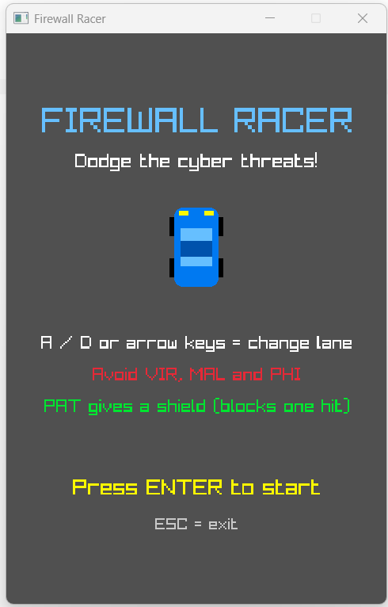
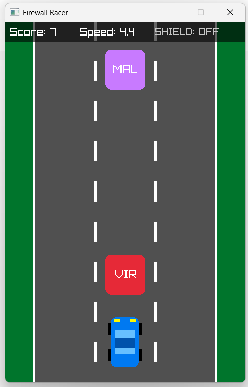
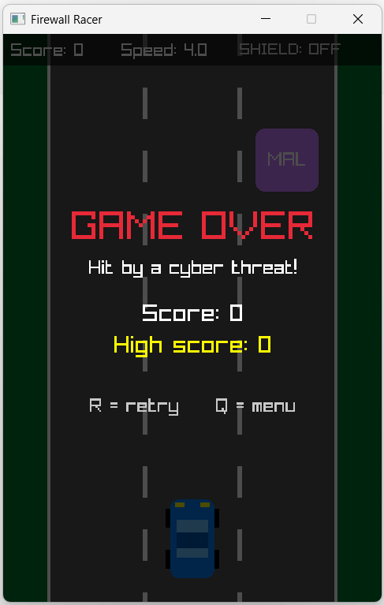

# Firewall Racer🚗

A simple 2D car game written in **C** using the [raylib](https://www.raylib.com/) graphics library. Drive down a 3-lane road, dodge cyber threats, and collect security patches to protect your car.

## Screenshots

| Start menu | Gameplay | Game over |
|:---:|:---:|:---:|
|  |  |  |

## About the game

You drive a blue car down a road with three lanes. Cyber threats fall from the top of the screen. Switch lanes to dodge them. Every threat you dodge gives you 1 point, and the game gets faster as your score grows. If you hit a threat, the game is over.

| Item | Looks like | What it does |
|---|---|---|
| **VIR** (virus) | Red box | Hit it and the game ends |
| **MAL** (malware) | Purple box | Hit it and the game ends |
| **PHI** (phishing) | Orange box | Hit it and the game ends |
| **PAT** (security patch) | Green circle | Gives you a shield that blocks one hit |

### Features
- Start menu, game screen and game over screen
- 3 lanes with smooth car movement
- Random falling obstacles
- Score, speed level and high score
- Shield power-up (a blue ring appears around the car)
- Speed increases every 5 points, up to a limit
- Car and obstacles are drawn with simple shapes, so no image files are needed

## Controls

| Key | Action |
|---|---|
| `A` or `←` | Move left |
| `D` or `→` | Move right |
| `ENTER` | Start the game |
| `R` | Retry after game over |
| `Q` | Back to the menu |
| `ESC` | Exit |


## Requirements

- Windows 10 or 11
- Visual Studio (2022 or later) with the **Desktop development with C++** workload
- The **raylib** NuGet package (installed in the steps below)

## How to clone and run

### 1. Clone the repository

Using Git:

```bash
git clone https://github.com/Anisha-8/firewall-racer.git
```

No Git? On the repository page click **Code → Download ZIP**, then unzip it.

### 2. Create a Visual Studio project

1. Open Visual Studio and choose **Create a new project**.
2. Select **Console App** with the **C++** language tag (not the C# one), then click **Next**.
3. Name the project `FirewallRacer` and click **Create**.

### 3. Add the game file

1. In **Solution Explorer**, right-click the default `.cpp` file, choose **Remove**, then **Delete**.
2. Right-click **Source Files** and choose **Add → Existing Item**.
3. Select `firewall_racer_raylib.c` from the folder you cloned.

The file ends in `.c`, so Visual Studio compiles it as C.

### 4. Install raylib

1. Right-click the project and choose **Manage NuGet Packages**.
2. Open the **Browse** tab, search for **raylib** and click **Install**.

### 5. Run

1. Set the platform at the top of Visual Studio to **x64**.
2. Press **Ctrl + F5** to build and run.

The game window will open on the start menu. Press `ENTER` to play.

## Author

[Anisha-8](https://github.com/Anisha-8)
